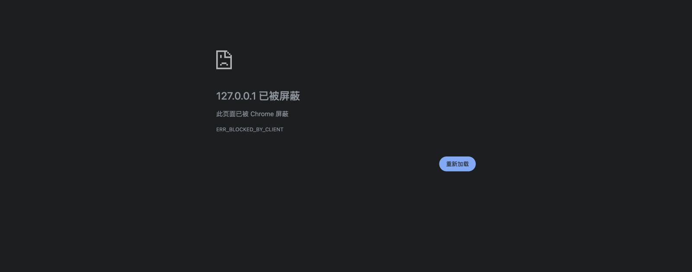

# Independent actual DSH Web validation gate

Validator: delegated `web_validation`, 2026-10-04. This agent is independent of the host/bootstrap implementation author. Session instructions require English delegation and Sol 6.1 xhigh for visual validation. Root controls Git. Initial inspected repository HEAD: `de1097e42fe08a34484c50bd34a240804e4ca52e` (historical planning snapshot). Final executable snapshot: `10723812a1f3a85425a5428212ee5febffa62e3d`, matched to the actual corrected-run source hashes below. This report does not accept the full BUB001 ticket, MVP or release.

**Final outcome: native Web profile/lifecycle PASS; rendered Web UI HOLD.** The isolated official `@deepseek-ai/dsh@0.2.1-alpha.1` runtime is installed with install scripts disabled. Its native Web profile loaded real bubbles, retained one synthetic entry through ten HMR reloads and process restarts, and disposed on full stop. Final corrected source scopes both DSH data roots to this project, with independent loopback active/stopped readbacks and zero sessions/inference attempts. The server is stopped and its ephemeral access file removed. Both documented CUA in-app and native Chrome tab surfaces rejected the loopback page before authentication or host-shell rendering. One unaltered Chrome rejection screenshot records that blocker. No token was read and no rendered-host/UI acceptance is claimed. This validator did not open a personal DSH profile or existing DSH installation.

## Authorized boundary and evidence interpretation

The owner authorized the latest official DSH Web release, isolated under this project, loopback-only browser validation, and mock/synthetic data. The approved boundary excludes Electron/Desktop compatibility or shims, personal profiles, credentials, paid/live inference, account/provider setup, and network exposure beyond loopback. Read-only app operations are authorized. A denied runtime-policy action must stop without bypass. The host author prepares and verifies the package, sanitized profile, fixture and supported runner; the validator must receive the runner-ready signal before opening a browser or starting a server.

Read before planning: [AGENTS](../../../AGENTS.md), [development workflow](../../development-workflow.md), [foundation contract](../../foundation-contract.md), [waves](../../waves.md), [M1 criteria](../../milestones/M1-foundation.md), [BUB001](../../tickets/BUB001.md), and [historical host evidence](host-interface.desktop-historical.md). The existing [Desktop smoke log](runs/desktop-de1097e/host-smoke.txt) exercises installed public Desktop-derived Cordis/session/approval packages. It cannot establish DSH Web package support, browser integration, Web-profile loading, responsive usability, login/logout, or actual host quit/restart behavior. Current Web acquisition/provenance is owned in [host-interface.md](host-interface.md).

M1 contains a native foundation service and no new BUB014 task-control UI. A future browser observation of the official host shell will validate that shell and supported plugin integration only. It will not accept BUB014 or the full MVP. A synthetic service fixture is kept distinct from an actual loaded Web-profile plugin and actual browser response.

## Acquisition and independent provenance

On 2026-10-04 `host_bootstrap` recorded the normal-sandbox command `npm view @deepseek-ai/dsh dist-tags version engines scripts dependencies --json`, exit 1, with `ENOTFOUND` / `getaddrinfo registry.npmjs.org`; npm also could not write its default log directory. The author initially stopped retries and escalation under the owner/root policy. This is a package-acquisition prerequisite failure; this validator did not encounter a browser or application failure because no runner existed. Root's later permitted lookup is recorded separately below and supersedes that initial acquisition block.

The author reported official README guidance for the canonical `npx @deepseek-ai/dsh web` command, `--no-open`, and loopback `127.0.0.1:3080`. That guidance is not proof of a downloaded release or a running route. Root then reported a successful narrowly approved registry lookup: the newest published official preview is `0.2.1-alpha.1`, published 2026-10-03 with the `alpha` tag, while the npm `latest` tag points to an older rc.2 published September 29. Root selected the exact `0.2.1-alpha.1` pin for this wave. The host author is continuing reviewed isolated acquisition. No floating tag, route or profile is inferred from those observations.

The target version is selected and installed manifests were read independently below. The controlled profile/runner were later supplied and inspected as recorded below. Acquisition/provenance is owned in the linked host document; the preceding paragraphs record directly received coordination reports and must not be mistaken for independently repeated install attempts.

The validator independently read `.runtime/npm-metadata/dsh-alpha.json`, the downloaded CLI manifest/README, and the isolated lockfile using built-in Node APIs. The CLI manifest is `@deepseek-ai/dsh` version `0.2.1-alpha.1`. The exact tarball `.runtime/dsh-web/review/deepseek-ai-dsh-0.2.1-alpha.1.tgz` is 24,302 bytes, SHA-256 `857f93aa6c85cbd92be3422380e5516f236dc5c49cda0405a958cbdf1865e8db`; computing its SHA-512 produced an exact match to the saved official registry integrity. Its source URL is `https://registry.npmjs.org/@deepseek-ai/dsh/-/dsh-0.2.1-alpha.1.tgz`. The inspected lockfile has lockfile version 3 and a root exact dependency of `@deepseek-ai/dsh: 0.2.1-alpha.1`; this read does not establish completed installation or lifecycle review of its dependencies.

The downloaded official CLI README states that `dsh web` boots the Web profile, whose native ordered bundle layers compose with `cordis.patch.yml` under the selected profile/DSH home. This confirms a native configuration mechanism exists. The actual project-local profile and plugin layer were then inspected as recorded below; no browser evidence route is registered by the foundation/observer. No dependency code was executed by these provenance reads.

After the author's installation signal, the validator independently read installed manifests under `.runtime/dsh-web/node_modules/@deepseek-ai/` and computed the following SHA-256 values. These are manifest hashes, not plugin source acceptance hashes. The read-only command ran under observed Node `v22.22.2`.

| Package | Installed version | Manifest SHA-256 |
| --- | --- | --- |
| `dsh` | `0.2.1-alpha.1` | `dbb4a7c1d88c412278fc8baccac7553f6d2310e85f5ffea1470a30106e99c688` |
| `cordis` | `4.0.5-alpha.1` | `37ac1aefbfc2a8d601bd061cec506159a1ca47aabf116f9682e4253fce1ead27` |
| `dsh-session` | `0.2.1-alpha.1` | `e9d5af863ff3cb1544425bf31902e78ef232f2d8d127cf6e5d90c245bc535d2c` |
| `dsh-user-approval` | `0.2.1-alpha.1` | `f18e487b31f9c92300be732674defca4ba3e1556fe94bf6b696aa71d0fbb4d7e` |
| `dsh-web-app` | `0.2.1-alpha.1` | `b502f63a057b1e388439c2a592ac16091d3c67fb9e76727b893f0d7a1325f8f5` |

## Actual running native profile and browser boundary

The author signaled ready at `http://127.0.0.1:3080`, official child PID 10122, runner PID 10115; the author retains stop/restart control. Launch command is `node scripts/dsh-web.mjs`. Independent source reads of that runner, `scripts/web-fixture.mjs`, and the actual profile manifest/patch confirm:

- Official CLI `lib/bin.js --profile web --host 127.0.0.1 --port 3080 --no-open` runs under observed Node `v22.22.2`. Final child environment contains fixed PATH, project-local `DSH_HOME` and `DSH_AGENTS_HOME`, telemetry-disabled and read-only permission entries. Working directory is the clean project `.runtime/dsh-web-workspace`; DSH_HOME is `.runtime/dsh-web-home`, and DSH_AGENTS_HOME is `.runtime/dsh-web-agents`. Earlier cycles preceded the second-root correction described below.
- The native profile manifest selects shipped `@deepseek-ai/dsh-base` and `@deepseek-ai/dsh-web-app` bundle layers. Its `cordis.patch.yml` inserts the local observer plugin through the official native loader. The observer imports real `createPlugin` from bubbles and injects a trusted synthetic owner/workspace callback in-process. Neither bubbles nor this observer registers a browser-callable task/operator/evidence HTTP endpoint.
- The observer submits the same synthetic input twice per activation, retains one ledger entry, captures allowlisted service diagnostics, holds a reference to test unload disposal, and blocks `agent/request` with `FIXTURE_INFERENCE_DISABLED`. The bubbles dispatch bridge remains deny-all, operator unavailable. Account/account-LLM/account-controller and LLM session-title features are disabled in this isolated test profile; no model/account setup or chat send occurred.
- Official URL printing is disabled. An ephemeral mode-600 private file carries the synthetic authenticated URL; no value from it was read or copied by this validator. A successful browser path must exchange the supported token and redirect to the clean root before saving evidence.

After ten actual profile HMR reloads, independent reads of `.runtime/dsh-web-evidence/state.json` and `profile-smoke.json` show child PID 10122 stayed active, generation 11, loads 11, unloads 10, entries 1, duplicate true, stale reference disposed, sessions 0, hostSupported true, target `dsh-web-0.2.1-alpha.1`, loopback true, port 3080 and inferenceAttempts 0. This is actual native Web-profile observation via the local fixture; it does not establish a browser-callable task service or a BUB014 UI.

Independent `lsof -nP -iTCP:3080 -sTCP:LISTEN` returned node PID 10122 listening on `TCP 127.0.0.1:3080 (LISTEN)`. A subsequent read-only `ps -p 10122 -o pid,ppid,command` was denied with `zsh:1: operation not permitted: ps` (exit 127). That inspection method stopped without retry, escalation or alternate process-inspection bypass.

The first CUA call used the documented `createBrowserTab("iab", "http://127.0.0.1:3080", { visible: true })` entrypoint. It returned `IAB visibility is not supported in a subagent thread`. The documented hidden option then returned `Browser Use cannot open http://127.0.0.1:3080 in tab 1. Browser reported: net::ERR_BLOCKED_BY_CLIENT`. The validator stopped the IAB route and reported both exact surface limitations to root.

Root explicitly directed a supported native Chrome surface for the same owner-authorized URL and a new labeled test tab. `createBrowserTab("chrome", "http://127.0.0.1:3080", { sessionName: "🫧 DSH Web validation" })` also returned `Browser Use cannot open http://127.0.0.1:3080 in tab 239481685. Browser reported: net::ERR_BLOCKED_BY_CLIENT`. No further navigation was attempted. Binding that failed test tab for cleanup showed an AX error document at `chrome-error://chromewebdata/`, title `127.0.0.1`, with the visible text `此页面已被 Chrome 屏蔽` and `ERR_BLOCKED_BY_CLIENT`; it did not show DSH. The documented screenshot API saved the unaltered 1600×631 JPEG [Chrome blocker](web/chrome-blocked-loopback.jpg), SHA-256 `ee2c5a92626e2306f2772700b3a5f6a7da6a3d1ecd60b27af888ab9a3f5ae220`. The failed Chrome test tab was then closed. No alternate proxy/port, browser-security bypass, token-bearing navigation or downloaded browser dependency was attempted.

## Coordinated full process lifecycle

After the browser blocker, the validator requested an author-controlled graceful stop of only the isolated runner and waited before restart. The author sent `TERM` to runner PID 10115 and reported exit 0 for its controlled exec session. The validator independently read phase `disposed`, loads 11/unloads 11, stale reference `disposed`, one durable entry, sessions 0/inferenceAttempts 0; `lsof -nP -iTCP:3080 -sTCP:LISTEN` returned exit 1 with empty output (no listener), and a built-in existence check reported the ephemeral access file absent without reading its value.

The same controlled profile then restarted under child PID 10939 (runner 10932). Independent `lsof` readback showed only PID 10939 listening at `127.0.0.1:3080`. The actual-profile state was active with loads 12/unloads 11, generation 11, one durable entry, `firstDeduplicated: true`, host supported, sessions 0 and inferenceAttempts 0. The first synthetic intake on restart matched the retained entry; no extra task or worker session appeared. The observer preserves only allowlisted counters across its own restart; no previous-process object reference is asserted to survive. The token file existed again, but its value was not read.

At 2026-10-04 06:31:13 UTC this readback and the exact production/runner/profile SHA-256 values were saved in [restart-readback.json](web/restart-readback.json). HEAD was `5a9618c1a2f10a7c3d2637206e3f47cedb433e45`; source hashes identify the actual inspected working files independently of later Git commits. Root owns final reviewed-tree linkage.

Root requested cleanup. The author gracefully stopped runner 10932 and reported exit 0. At 06:33:04 UTC the validator independently observed no listener (`lsof` exit 1/empty), phase disposed, loads 12/unloads 12, stale reference disposed, one durable entry, sessions 0/inferenceAttempts 0, and the private access file absent. [That stop readback](web/final-stop-readback.json) records the result and verifies all inspected production/runner/profile hashes were unchanged since the restart readback.

After exact `host:setup` reproducibility and the CR11 bounded-output helper correction, the author ran additional short cycles. The validator independently observed child PID 11379 active at 06:36:09 UTC, loads 14/unloads 13, one retained entry, sessions 0/inferenceAttempts 0, and the sole loopback listener. [Pre-CR12 helper readback](web/final-helper-active.json) captures the inspected source hashes including runner `91d0bda7174ada145c57b6f9be49395a220fd09000fb5a7a616dc3c5c0dc4c62`.

Audit CR12 then identified that filesystem skills uses a separate supported user-agents root. The author stopped that cycle and added a project-local `DSH_AGENTS_HOME` beside `DSH_HOME`. The author reports its public provider roots-only regression returned exactly project home/skills and agents/skills without listing/body access, and its full unit suite passed 109/109. Earlier readbacks remain valid lifecycle observations but do not certify the corrected final environment. The author reports no personal-root listing/body access, browser auth or session/model operation occurred; this validator performed none.

The corrected final source was held active as runner 11550/child 11557. At 06:40:03 UTC the validator independently confirmed the sole listener `127.0.0.1:3080` belonged to 11557, state active loads 15/unloads 14, one retained entry/firstDeduplicated true, sessions 0/inferenceAttempts 0 and supported host. Read-only source inspection confirmed both fixed project-local environment bindings and metadata confirmed the project agents directory existed; no skill directory listing or body read was performed. [Corrected active readback](web/final-environment-active.json) captures the complete inspected source/profile hash set, including corrected runner SHA-256 `30dbb53a9e00255cde51ce9bf79db21fd7287726ec9ef7cd6ec5065d97bf39cf`.

After the validator signaled final-stop readiness, the author sent `TERM` only to runner 11550 and reported exec exit 0. At 06:41:14 UTC independent [corrected stopped readback](web/final-environment-stopped.json) found phase disposed, loads 15/unloads 15, stale reference disposed, one retained entry, sessions 0/inferenceAttempts 0, private access file absent and no source/profile hash changes since the corrected active run. Independent `lsof` again returned exit 1/empty for port 3080. The final isolated Web server is stopped.

At 06:42:24 UTC [final snapshot linkage](web/final-snapshot-linkage.json) independently hashed the committed source bytes at `10723812a1f3a85425a5428212ee5febffa62e3d` and found zero mismatches against all seven tracked runtime files in the corrected active readback. Exact Git objects: src tree `5757faf909ca9bde505f16b0f2e0627a6c15c894`, test tree `48f09c19266bc7bbc8921f92ce6c11a377db4af5`, scripts tree `cd5f924625ab4ea44fe2f7addeca96273d6cee50`, package.json blob `c03a776bdc6c98525a23044dd9574b65eea301e9`. Ignored runtime profile bytes are identified by their separate saved SHA-256 values. No browser navigation was retried after the source corrections because the surface block remained unresolved.

This lifecycle evidence covers a real official Web host process and native plugin. It does not establish browser-window-close behavior, logout, arbitrary external effects, provider reconciliation or BUB014 controls.

## Independent browser test design

Browser rows below are **blocked / not run** unless otherwise stated. Expected routes and supported controls are learned from the concrete release and reviewed runner. Tests use native CUA browser controls. No Playwright or other downloaded browser dependency is authorized.

| Check | Expected behavior / evidence required | Actual result |
| --- | --- | --- |
| Provenance and startup | Record exact official preview version, integrity/source pin, runtime version, reviewed launch command, sanitized project-local profile/config/fixture, loopback listener and absence of personal-profile discovery. | Independently inspected tarball, manifests, corrected runner/profile, both project-local data-root bindings and loopback listener; saved source hashes match the final committed runtime. |
| Official Web shell | Open only the ready loopback URL; record final URL, page title, initial rendered state and screenshot. Shell loads without an unexpected credential/provider prompt or fatal error. | Both CUA IAB and native Chrome rejected the clean loopback root with `net::ERR_BLOCKED_BY_CLIENT`; no host shell observed. Chrome rejection screenshot saved. |
| Native plugin loading | The real bubbles plugin is loaded through the release's supported Web-profile mechanism. Record actual config/diagnostics and host capability results, with source/version pin. Missing services or malformed config fail before intake. | Actual native Web profile loaded; independently read active observer reports supported service. Browser diagnostics not assessed. |
| Safe browser integration | If the release supports a safe synthetic evidence route, browser access returns evidence from the actual loaded plugin. Check observed route/method against reviewed source; prove synthetic deduplication and bounded rejection without inference. Separate any fixture-only response from native browser integration. | No evidence/task HTTP route is exposed by design. Local observer proves native loading; no browser-callable bubbles-service claim. |
| Reload/unload | Where safe controls exist, unload rejects stale plugin references, reload restores one service, and ten reloads yield one entry per synthetic input with no duplicate handlers or worker sessions. Browser observations supplement native runtime evidence. | Independently read author-run ten native profile reload snapshots: loads 11/unloads 10, one retained entry, stale reference disposed, sessions 0. Browser reload controls not assessed. |
| Config and missing capability | With a separately prepared synthetic negative profile, malformed config and absent services yield stable diagnostics, do not expose synthetic secret text, and do not admit work. | Not run; no negative profile. |
| Visual usability | Inspect default desktop width, a narrower viewport, and supported navigation/control states. Verify legible text, reachable primary controls, visible overflow/focus, and no clipped critical diagnostics. Save unaltered screenshots under `web/` with observed viewport size. | Blocked; no DSH UI rendered. Only the browser rejection screen was captured. |
| Errors | Observe visible host/plugin errors and supported browser error information. Record exact stable codes and expected/actual state; do not claim browser-console checks unless the available tool exposes them. | Browser surface errors recorded and rejection page observed. DSH-rendered errors and console checks not run. |
| Logout | Only exercise a supported synthetic/local logout flow if the isolated host exposes it; record session/profile state and effects. Do not sign into or configure a personal/provider account. If no logout exists, mark not applicable with observed basis. | Not assessed. |
| Browser close | Close only the isolated test tab when supported; independently inspect host process/plugin state. A closed tab must not be claimed as a full host quit. | Failed Chrome test tab closed for cleanup after full host stop; actual DSH-window-close lifetime not established. |
| Full stop and restart | Coordinate stopping only the isolated host with its author. Record listener/process termination, plugin disposal and subsequent safe restart/recovery from synthetic durable facts. Never replay unknown effects. | Graceful stops and intervening restarts independently verified, including the corrected final source. Retained entry deduplicated, no additional session/inference; final state disposed 15/15 and no listener/access file. |
| Zero inference | Host fixture records zero model/provider calls and rejects dispatch by default. No chat send, model/account setup, external provider or paid inference is used. Check logs/evidence without printing secrets. | Validator calls zero; actual-profile observer inferenceAttempts 0 and sessions 0. |

## Acceptance disposition

- Native Web-profile loading, author-run HMR, independently observed disposal/listener termination and durable restart PASS as bounded evidence. Corrected final data-root execution/disposal and final committed-source linkage are complete. Actual browser functional/visual gates remain HOLD before observing the host shell.
- BUB001-01..05 are not accepted by this document. Historical Desktop public-service fixture evidence remains historical and separate.
- BUB014 remains future work; no task UI was built or validated here.
- Actual rendered-host validation needs an owner-authorized browser surface that can reach the same loopback host; both attempted documented surfaces rejected it. Do not alter network exposure, route around the block, or mark host UI checks passed. If code/config changes after runtime tests, compare the saved source hashes and rerun the affected checks before acceptance.
- No production code, package metadata, Git state, personal configuration or existing DSH installation was changed by this validator. Only this evidence document, the browser-rejection screenshot and allowlisted readback files were created. No browser dependency was downloaded, no inference was called, and no sandbox escalation or bypass was attempted by this validator. Author/root approved installation and loopback-launch escalations are recorded in their separate evidence.
